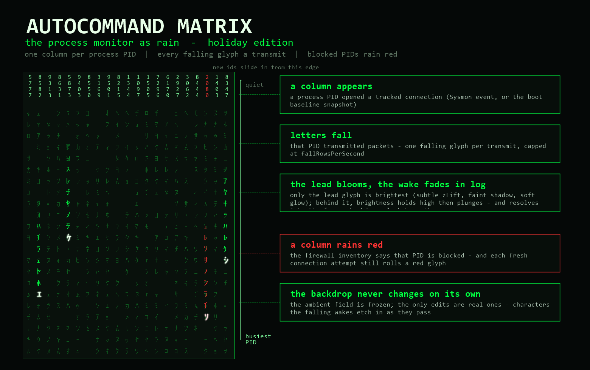
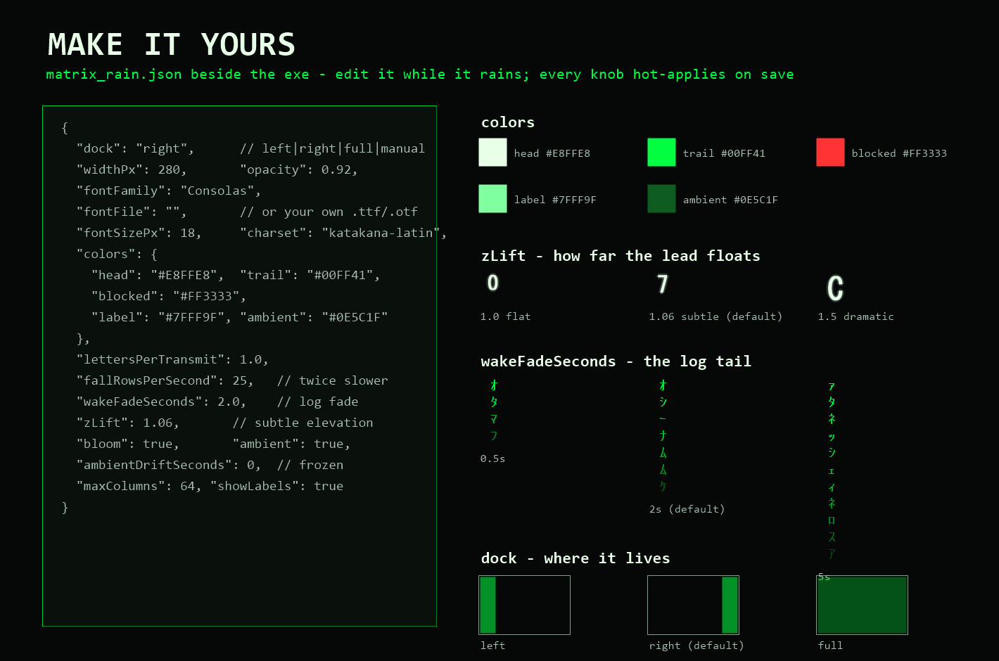
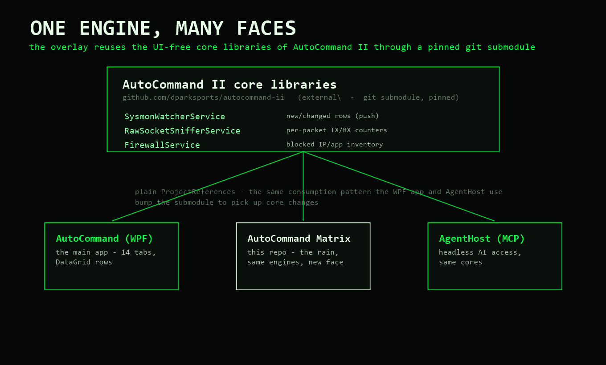

# AutoCommand Matrix

**The holiday-edition process monitor: your PC's network traffic as Matrix rain.**



AutoCommand's Process Monitor shows one boring row per (process → remote IP)
conversation. This overlay runs the same engines — the UI-free core
libraries of [AutoCommand II](https://github.com/dparksports/autocommand-ii),
pinned as a git submodule — but rains them down your screen instead:

```
 2   4   8   16  31          ← PIDs, one column per process instance
 0   0   8   4   2
 4   4   4   2   0   ﾊ
 8   8   0   8   4   ﾘ   ﾊ
 ﾊ   2   4   ﾘ   2   ﾋ   ﾍ
 ﾘ   8   8   ﾔ   4   ﾆ   ﾄ   ← every falling glyph = one transmit
 ﾂ   0   2   0   8   ﾈ   ﾗ     by that PID (≈ one TX packet)
 4   4   ﾔ   4   0   ﾄ   ﾈ
 8   0   2   2   ﾊ   ﾚ   ﾎ
```

- **One rain column per process instance PID**, labeled at the top.
- **Falling letters are transmits** — each glyph that drops is a packet that
  PID put on the wire. A chatty process streams; a quiet one trickles; an
  idle one goes still and fades.
- **A traffic-blocked PID rains red.** Block a process or an IP (in
  AutoCommand, or any firewall rule AutoCommand recognizes) and its column
  switches to red glyphs — and keeps rolling a slow red heartbeat while it
  still tries to phone home.
- **Transparent and dockable** — a slim always-on-top pane on the left or
  right edge of your desktop, out of the way of everything. It covers the
  whole desktop only if you explicitly tell it to. By default it lives one
  layer down — **over the desktop only, behind application windows** —
  like a living wallpaper; switch to the always-on-top overlay whenever.
- **Your colors, your font** — the glyph palette and typeface are plain JSON
  beside the exe; point it at any installed font or your own `.ttf`/`.otf`.
- **A frozen backdrop under the rain** — a dim field of ambient glyphs at a
  steady brightness that never changes on its own; the only backdrop edits
  are real ones, characters the falling wakes etch in as they pass.
  (Opt-in drift eases the field downward, off by default.)
- **Columns slide, they don't pop** — a new PID's column slides out from
  the docked edge into place, and activity re-ranking glides columns
  between slots instead of teleporting them.
- **Only the lead blooms; the wake fades in log; the z-lift is subtle** —
  each falling stream is a single bright lead glyph with a soft glow, at a
  hair over background height (`zLift` 1.06: it reads same-size at a
  glance — watch carefully to catch the slight scale, faint shadow and
  bloom), trailed by the characters it has passed, each decaying on a
  logarithmic curve: brightness holds high (~73% at half-life) then
  plunges, a long silky tail rather than a quick exponential vanish. As a
  wake character finishes fading it resolves into the identical backdrop
  glyph etched beneath it.
- **Hover a column** (when click-through is off) for the story: process
  name, tx/rx counters, tracked connections, block state.

## Prerequisites

| Requirement | Why | Without it |
|---|---|---|
| Windows 10/11 x64 | raw sockets, WPF | — |
| Administrator (UAC prompt) | raw-socket sniffing (SIO_RCVALL), Sysmon log, firewall inventory | the app cannot start |
| Sysmon (optional) | live per-connection events | falls back to a kernel TCP-table snapshot — established connections still get columns, new ones appear on the slower snapshot path |
| Windows Firewall (optional) | the red blocked mode | no red; the rain stays green |

The self-contained release zip needs no .NET install.

## Getting it

Grab `AutoCommand-Matrix-v*-win-x64.zip` from
[Releases](https://github.com/dparksports/autocommand-matrix/releases),
unzip, unblock (`Unblock-File` or file Properties), run `AutoCommand.Matrix.exe`,
accept the UAC prompt. A green **M** tray icon appears; the rain docks to
the right edge of the desktop.

## The tray menu (the whole UI)

| Menu item | Effect |
|---|---|
| Dock left / right | snap to that edge of the work area (taskbar stays visible) |
| Dock full screen | the explicit whole-desktop mode |
| Manual (drag the rain) | drag the pane anywhere; position is remembered |
| Over the desktop only | paint the rain over the desktop but **behind application windows** — visible wherever the desktop shows (default on) |
| Click-through | the overlay ignores the mouse entirely (tooltips off too) |
| PID labels | show/hide the per-column PID digits |
| Rain on receives too | also rain (in blue) on inbound packets |
| Fall slower / Fall faster | nudge the fall speed live (×0.75 / ×1.33, saved to `fallRowsPerSecond`) |
| Edit matrix_rain.json | open the config in Notepad — save and it hot-applies |
| Reload config | re-read the file now |
| Exit | quit (Alt-F4 merely hides to tray) |

## Configuration — `matrix_rain.json`



Written beside the exe on first run, re-read on every save — change the
font or colors while it's raining and watch it re-skin live.

```json
{
  "style": "cinema",
  "dock": "right",
  "surface": "desktop",
  "widthPx": 280,
  "opacity": 0.92,
  "clickThrough": false,
  "fontFamily": "Consolas",
  "fontFile": "",
  "fontSizePx": 18,
  "charset": "katakana",
  "colors": {
    "head": "#E8FFE8",
    "trail": "#00FF41",
    "blocked": "#FF3333",
    "blockedHead": "#FFDDDD",
    "label": "#7FFF9F",
    "rx": "#2E7DFF",
    "ambient": "#0E5C1F"
  },
  "lettersPerTransmit": 1.0,
  "maxColumns": 64,
  "blockPollSeconds": 60,
  "showLabels": true,
  "rxMode": false,
  "ambient": true,
  "ambientDriftSeconds": 0,
  "ambientDensity": 0.9,
  "zLift": 1.06,
  "bloom": true,
  "wakeFadeSeconds": 2.0,
  "fallRowsPerSecond": 25
}
```

| Key | Meaning |
|---|---|
| `style` | `cinema` (default — the movie look: a decorative wall of independent green streams behind the data columns, white lead tips, bold glyphs, silky exponential trails) \| `instrument` (the original minimal look — dark glass, only real traffic rains, frozen backdrop) |
| `dock` | `left` \| `right` (default) \| `full` (whole desktop — explicit) \| `manual` |
| `surface` | `desktop` (default — rain over the wallpaper, **covered by application windows**) \| `overlay` (above everything) |
| `widthPx` | side-dock pane width in DIPs |
| `opacity` | window-level opacity, 0.30–1.00 |
| `clickThrough` | mouse-transparent overlay |
| `fontFamily` | any installed family — monospace fonts look the most Matrix |
| `fontFile` | absolute path to a `.ttf`/`.otf`; overrides `fontFamily` — the rain runs in *your* font |
| `fontSizePx` | glyph size (cell width follows the widest glyph) |
| `charset` | `katakana` (default — katakana + machine symbols, no roman letters or digits) \| `katakana-latin` \| `latin` \| `digits`, or a literal string of ≥4 characters |
| `colors.head` / `trail` | the bright lead glyph / the decaying trail |
| `colors.blocked` / `blockedHead` | what a blocked PID rains |
| `colors.label` | the PID digits |
| `colors.rx` | receive glyphs, when `rxMode` is on |
| `lettersPerTransmit` | letters bought per TX packet; auto-scales down under heavy traffic so a busy PID streams fast instead of turning into a solid wall |
| `maxColumns` | rain columns before the stalest PID gives up its slot |
| `blockPollSeconds` | firewall block-inventory poll (red-mode freshness) |
| `showLabels` | the vertical PID digits atop each column |
| `rxMode` | also rain on receives |
| `ambient` | dim backdrop glyph field behind the rain, steady brightness |
| `ambientDriftSeconds` | seconds per backdrop row drift — 0 (default) freezes the backdrop; only falling wakes change it |
| `ambientDensity` | fraction of backdrop cells carrying a glyph |
| `zLift` | lead-glyph elevation — subtle by default (1.06): same height as the background unless you watch carefully (1.0 = flat, up to 1.6 = dramatic) |
| `bloom` | glow halo on the falling lead glyph only — the wake never blooms |
| `wakeFadeSeconds` | trail length in characters behind the lead (× fallRowsPerSecond, clamped 8–80) — trailing characters share the lead's brightness, dimmer incrementally by distance |
| `fallRowsPerSecond` | fall-speed ceiling in glyph rows per second — also adjustable live from the tray (Fall slower / faster) |
| `colors.ambient` | the backdrop glyph color |

Blocked-state changes can lag the firewall by up to `blockPollSeconds`
(same cadence as AutoCommand's own Process Monitor tab).

## Two styles — `cinema` and `instrument`

The original build rained only on real traffic — precise, but it didn't look
like the film. `style: "cinema"` (the default) recreates the movie's wall:
every column streams continuously at its own speed with a bright white tip,
glyphs are bold and stacked tight, and the whole pane carries the classic
silky green decay. The real telemetry rides **on top** of that wall — your
live PID columns keep their bloom, wake trails, red blocked-glyphs and PID
labels, so a busy process still visibly outshines the decoration around it.
`style: "instrument"` switches back to the quiet original: nothing moves
unless something transmits. Toggle it live from the tray
(**Movie look (cinema)**), or set `style` in the JSON — the two styles share
every other knob (font, colors, speed, charset).

## How the rain maps to reality

| In the rain | On your machine |
|---|---|
| a column appears | a process PID opened a tracked network connection (Sysmon event, or the boot baseline snapshot) |
| letters fall | that PID transmitted packets — one glyph per transmit |
| where a column sits | edge-anchored activity ranking — the busiest PID's column hugs the edge the pane is docked against (rightmost when docked right, leftmost when docked left), re-ranked every ~2 s; new columns slide out from the docked edge, re-ranks glide |
| column goes red | the firewall inventory says that PID's traffic (its process path or remote IP) is blocked |
| red letters keep falling | the blocked process is *still trying* — each new connection attempt rolls a glyph |
| a column stills and fades | the process went quiet (or exited) |
| hover tooltip | PID, process name, tx/rx packets & bytes, connection count, block state |

## Building

```powershell
git clone --recursive https://github.com/dparksports/autocommand-matrix.git
cd autocommand-matrix
dotnet build AutoCommand.Matrix.csproj -c Release
```

The `--recursive` matters: the AutoCommand II core libraries (NetWatch /
Intercept / Contain) are a pinned git submodule under `external/`, consumed
the same way the main app consumes them — plain `ProjectReference`s to
UI-free class libraries. They are not on NuGet; to pick up core changes,
bump the submodule and commit the new gitlink.

`.\run.ps1` is the dev loop: it elevates (UAC), stops a running instance,
rebuilds Release, and relaunches — a running elevated instance otherwise
locks `bin\Release` against a plain shell.

Running from a dev shell needs an elevated shell (the manifest demands
administrator for the raw socket).

## Performance notes

Rendering is one `WriteableBitmap` composited on the UI thread: per frame a
premultiplied alpha fade pass plus pre-rasterized glyph blits — no text
layout on the hot path. Side docks run at 60 fps; the full-desktop dock
drops to 30 fps to keep the 2M-pixel fade cheap.

## Privacy

The overlay is a pure observer: it makes **no outbound network requests of
its own** (the DNS/RDAP geo resolver inside the core is deliberately left
unstarted — the rain never shows hostnames). It reads the Sysmon event log,
a local raw socket, and the firewall's block inventory. Nothing leaves the
machine.

## Relation to AutoCommand



This is a standalone face over the
[AutoCommand II](https://github.com/dparksports/autocommand-ii) core
engines — `SysmonWatcherService` and `RawSocketSnifferService` feed the
exact same shared row table the main app's Process Monitor tab uses;
`FirewallService.GetBlockedInventoryAsync()` is the red-mode truth source.
"One engine, many faces": AgentHost (headless MCP), the WPF app, and now
the rain.

Licensed Apache-2.0, like everything in the AutoCommand family.
